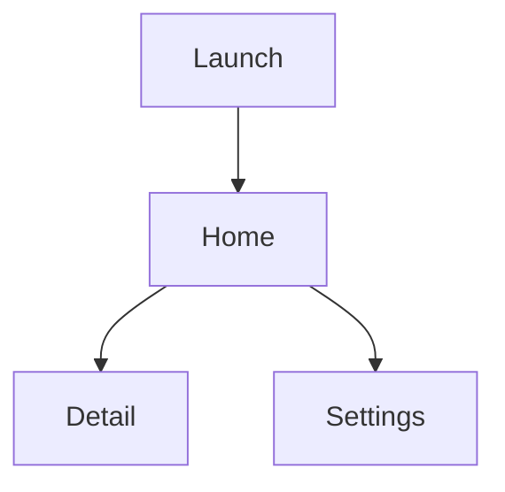

# Screen inventory — {{APP}}

Walk the running app like a user. **Do one pass per area, then repeat** — a single traversal only finds the
happy path. Then converge the runs into one flow map and resolve the discrepancies.

Confidence: `confirmed` (seen, ≥2 sources) · `inferred` · `unverified`

---

## Navigation map

## Screens

### Screen: <name>

- **Entry points:**
- **Purpose:**
- **Confidence:** confirmed | inferred | unverified
- **States observed:** empty | loading | populated | partial | error | offline | permission-denied
- **Data shown:** (field → source: endpoint / local store / computed)
- **Actions:**

  | Control | Behaviour | Calls | Destination | Errors |
  |---|---|---|---|---|
  |  |  |  |  |  |

- **Transitions:**
- **Edge cases:**

  | Scenario | Behaviour | Evidence |
  |---|---|---|
  | empty |  |  |
  | very large |  |  |
  | offline |  |  |
  | expired session |  |  |

- **Evidence:** (har ref / screenshot / class:line)

---

## Global chrome

- Tab bar / nav structure:
- Modal and sheet patterns:
- Global error and retry presentation:
- Loading presentation (skeleton / spinner / optimistic):
- Empty-state presentation:

## Session lifecycle

| Event | Behaviour |
|---|---|
| Cold start, no session |  |
| Cold start, valid session |  |
| Session expires mid-use |  |
| Background / foreground |  |
| Logout |  |
| Account deletion |  |

## Edge-case matrix (the deliverable that matters)

| # | Scenario | Expected behaviour | Evidence | Rebuild status |
|---|---|---|---|---|
| 1 | empty list |  |  | ☐ |
| 2 | one item |  |  | ☐ |
| 3 | many items |  |  | ☐ |
| 4 | very large list |  |  | ☐ |
| 5 | malformed / hostile input |  |  | ☐ |
| 6 | offline, cached |  |  | ☐ |
| 7 | offline, no cache |  |  | ☐ |
| 8 | slow network |  |  | ☐ |
| 9 | 401 mid-session |  |  | ☐ |
| 10 | 429 rate limited |  |  | ☐ |
| 11 | server 500 |  |  | ☐ |
| 12 | concurrent edit |  |  | ☐ |
| 13 | first run |  |  | ☐ |
| 14 | upgrade from older version |  |  | ☐ |
| 15 | permission denied |  |  | ☐ |

## Converge notes

Where repeated walks disagreed, and how it was resolved:
-
