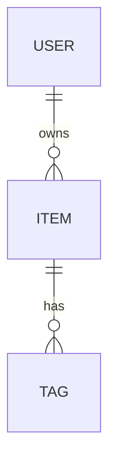

# Data model — {{APP}}

Triangulated three ways: **wire** (response shapes), **local** (what's actually persisted), **code**
(model/deserialiser classes). Where two of three agree, mark `confirmed`.

---

## Entities

### Entity: <Name>

- **Confidence:** confirmed | inferred | unverified
- **Storage tiers:** server-only | cached | local-first
- **Wire source:** (endpoint)
- **Local store:** (sqlite table / Realm object / Core Data entity / IndexedDB store / UserDefaults key)
- **Code reference:** (model class)
- **Sync:** poll | push | manual refresh | none
- **Conflict handling:**
- **Retention / eviction:**

| Field | Type | Required | Constraints | Notes |
|---|---|---|---|---|
|  |  |  |  |  |

---

## Local storage inventory

| Store | Location | Contents | Encrypted? | Sensitivity |
|---|---|---|---|---|
| sqlite |  |  |  |  |
| prefs / plist |  |  |  |  |
| keychain / keystore |  |  |  |  |
| files / cache |  |  |  |  |
| IndexedDB / localStorage |  |  |  |  |

## Relationships

## Lifecycle

| Entity | Created by | Updated by | Deleted by | Cascade |
|---|---|---|---|---|
|  |  |  |  |  |

## Migrations and versioning

- Schema version:
- Observed migration behaviour (old → new):
- What happens to unparseable local data:

## Open questions

-
